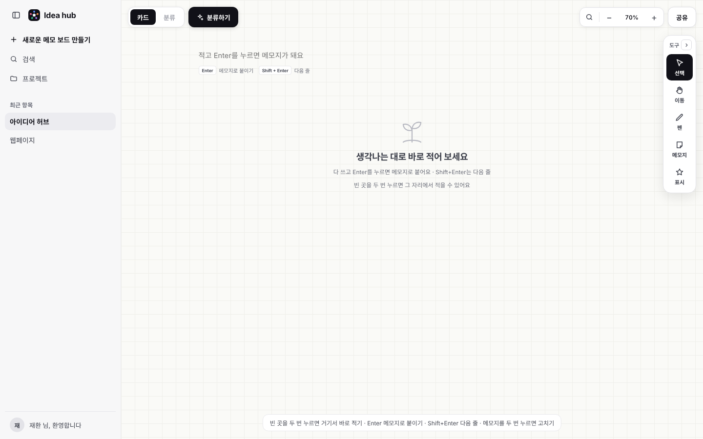
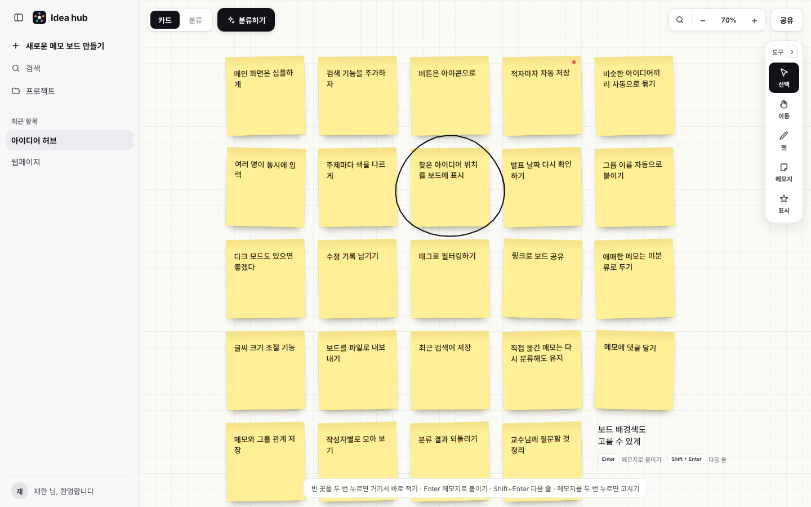

# 보드 화면 시안 — 메모 쓰기 · 분류하기

담당: 이재환 · 브랜치 `feature/board-ui`

입력칸 없이 **메모장처럼 바로 적고 → Enter로 메모지를 붙이고 → "분류하기"로 주제별로 모으는** 보드 화면 시안입니다. 팀 와이어프레임을 바탕으로 만들었고, 마인드맵은 이번 범위에서 뺐습니다.

> **직접 눌러 보려면:** 이 폴더의 `index.html`을 열고 오른쪽 위 **Download raw file** 버튼으로 내려받은 뒤 두 번 누르면 브라우저에서 열립니다. 설치할 것은 없고, 파일 하나만 있으면 됩니다.

## 한눈에 보기

### 1. 빈 보드 — 바로 적기 시작
보드를 열면 입력칸 없이 바로 글을 적을 수 있는 상태입니다. 생각나는 대로 적으면 됩니다.

### 2. 메모장처럼 이어 적기
- `Enter` → 지금 적은 글이 노란 메모지로 붙고, 바로 아래에 다음 줄이 준비됩니다.
- `Shift + Enter` → 메모지로 바꾸지 않고 줄만 바꿉니다.
- 빈 곳을 **두 번 누르면** 그 자리에서 새로 적을 수 있고, 붙은 메모지를 두 번 누르면 고칠 수 있습니다.

### 3. 메모지 보드
메모가 쌓이면 이렇게 보입니다. 오른쪽 도구 창에서 펜(동그라미 치기), 표시(빨간 별) 등을 쓸 수 있습니다.

### 4. 분류하기 결과
위쪽 **분류하기**를 누르면 비슷한 메모끼리 주제별 줄로 모이고, 주제마다 색이 다른 메모지로 바뀝니다.
- 메모를 누르면 다른 주제로 옮길 수 있습니다(옮긴 메모에는 "고정" 표시).
- 주제 이름을 누르면 그 줄을 접고 펼칩니다.
- **카드** 탭으로 돌아가면 원래 자리에서 색만 바뀐 채로 보입니다.

## PRD 요구사항과 연결

| PRD | 시안에서 해 볼 수 있는 것 |
|---|---|
| F-001 카드 생성·수정·삭제 | Enter로 메모지 붙이기, 두 번 눌러 고치기, 메모지를 누르면 나오는 막대에서 삭제 |
| F-003 사용자 요청 기반 자동 그룹화 | 분류하기 버튼, 어디에도 안 맞는 메모는 미분류 |
| F-004 그룹화 결과 시각화 | 주제별 줄과 주제 색 메모지 |
| F-005 분류 결과 수동 수정 | 분류 화면에서 메모를 눌러 다른 주제로 옮기기 (그룹명 수정은 아직 없음) |
| F-006 사용자 수정 결과 보존 | 옮긴 메모는 "고정"되어 다시 분류해도 그대로 |
| F-007 그룹·아이디어 조회 | 메모 찾기, 주제 줄 접고 펼치기 |

F-002(저장·조회)는 서버와 연결하면서 붙일 부분이라 시안에는 없습니다.

## 열 때 고를 수 있는 화면

| 주소 | 처음 화면 |
|---|---|
| `index.html` | 예시 메모 24개가 붙어 있는 보드 |
| `index.html?board=new` | 빈 보드 (사이드바의 "새로운 메모 보드 만들기"도 같은 화면) |
| `index.html?board=groups` | 분류가 끝난 상태 |

## 지금 시안에서 아직 가짜인 부분

- 서버·DB와 연결되지 않아서 새로고침하면 적은 메모가 사라집니다.
- 분류는 AI가 아니라 화면 안의 간단한 단어 규칙("검색", "저장" 같은 단어)으로 흉내 냅니다.
- 메모 찾기, 확대·축소, 사이드바 접기는 동작하지만 공유 버튼과 사이드바의 프로젝트·최근 항목은 모양만 있습니다.

## 파일

- `index.html` — 화면 전체. 위쪽 `render()` 안의 템플릿이 화면 구조, 아래쪽 `Board` 클래스가 동작(메모 추가·분류·배치 계산)입니다. 화면을 그리는 작은 라이브러리(Preact + htm, 13KB)도 파일 맨 위에 함께 들어 있습니다.
- `screenshots/` — 위의 화면 캡처 4장
- `LICENSE-htm.txt` — 함께 넣은 라이브러리의 라이선스(htm, Apache-2.0). Preact(MIT) 고지는 맨 아래에 있습니다.

## React로 옮길 때 참고

- `Board` 클래스는 React의 클래스 컴포넌트와 같은 방식(`state`, `setState`)이라 거의 그대로 옮길 수 있습니다. 템플릿의 `style="..."` 문자열은 React에서는 객체로 바꿔야 합니다.
- 메모 데이터는 `{ id, text, g(주제), x, y, marked, pinned }` 형태입니다. `docs/api-db-contract.md`의 `ideas` 테이블과 맞출 때 `g`는 `group_id`, `pinned`는 `assignment_is_manual`에 해당합니다.
- "분류하기"의 `classify()`가 서버의 `POST /boards/{board_id}/analyze`를 부를 자리입니다.

---

Preact 고지: Copyright (c) 2015-present Jason Miller. MIT License — Permission is hereby granted, free of charge, to any person obtaining a copy of this software and associated documentation files (the "Software"), to deal in the Software without restriction, including without limitation the rights to use, copy, modify, merge, publish, distribute, sublicense, and/or sell copies of the Software, and to permit persons to whom the Software is furnished to do so, subject to the following conditions: The above copyright notice and this permission notice shall be included in all copies or substantial portions of the Software. THE SOFTWARE IS PROVIDED "AS IS", WITHOUT WARRANTY OF ANY KIND, EXPRESS OR IMPLIED.
